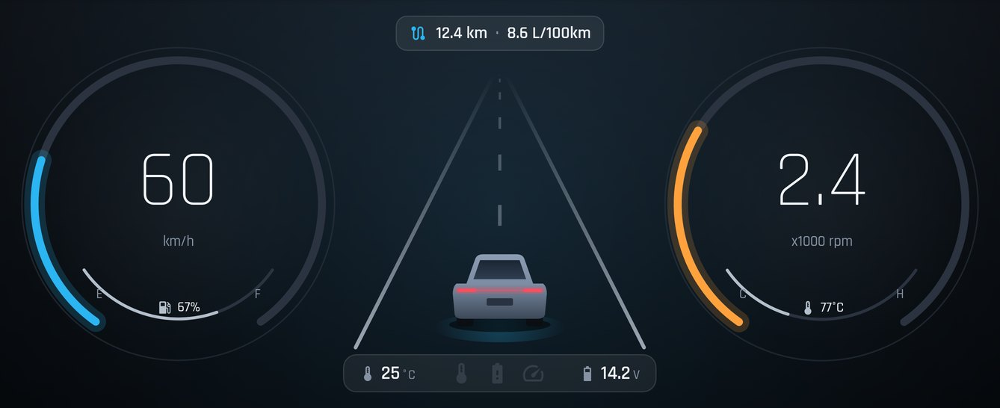
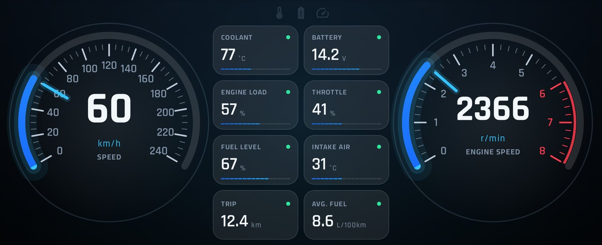
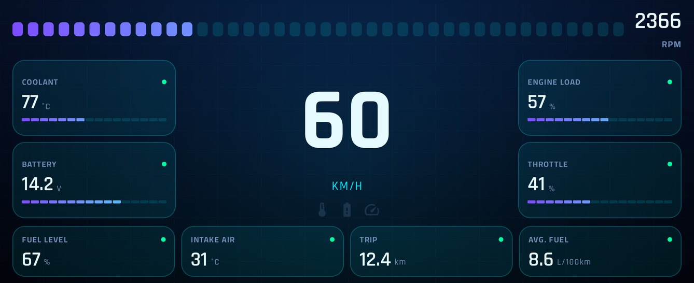
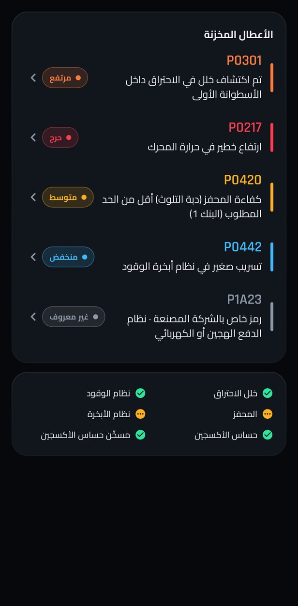

# JAC DRIVE – Ultimate Smart Cockpit

A native Android companion app for the **JAC J7 2026 Ultimate**: a customizable digital cockpit,
OBD-II live data and diagnostics through a Bluetooth ELM327 adapter, vehicle health, performance
timing, trip analytics and maintenance tracking. Arabic and English with full RTL.

Target device: Xiaomi Redmi Note 15 (any Android 8.0+ phone works; `minSdk 26`, `targetSdk 35`).

> **Status: Phase 4 of 5 complete.** Cockpit (6 themes, 4 layouts), demo mode, Bluetooth Classic
> ELM327 connection, live data, fault-code scanner, bilingual DTC database, diagnostic history,
> health score, trip recording and analytics, performance timers and maintenance management are
> implemented. Voice alerts, backup/restore and the Android Auto decision are Phase 5.
> Screens whose engine arrives in a later phase are visibly marked **"In development"** in the app.



| JAC Original | Cyber Blue · Digital | Sport GT · Sport center |
|---|---|---|
|  |  |  |

*Rendered from the real Compose code by the screenshot tests, using demo-mode (simulated) values.*

---

## Architecture

Kotlin · Jetpack Compose · Material 3 · MVVM + clean layering · Coroutines/Flow · Hilt · Room ·
DataStore · Navigation Compose · Gradle Kotlin DSL with a version catalog.

```
app ──► dashboard ──► vehicle ──┐
   ├──► diagnostics ─┐          │
   ├──► analytics ───┼──► obd ──┼──► core-ui ──► core
   ├──► maintenance ─┘          │
   └──► settings ───────────────┘
```

| Module | Responsibility |
|---|---|
| `core` | Domain models (`VehicleMetric`, `LiveValue`, `DataSource`, `VehicleSnapshot`, units), settings repository (DataStore), Room database, DI (dispatchers, app scope). No UI. |
| `core-ui` | Design system: typography (Cairo + Rajdhani), app theme, the five cockpit styles, Canvas gauge renderer (`CircularGauge`, `BarGauge`), cockpit backgrounds, shared components, immersive-mode helper. |
| `obd` | Live-data pipeline. `VehicleDataRepository` is the single source of truth for every screen. Bluetooth Classic transport (BLE-ready `ObdTransport` interface), ELM327 parser/initialiser, SAE J1979 PID decoder, polling session, connection manager with auto-reconnect, `connectedDevice` foreground service, demo simulator. |
| `vehicle` | Vehicle profile (Room) with VIN validation. |
| `dashboard` | Home hub and the full-screen cockpit (3 layouts, warning lamps, freshness). |
| `diagnostics` | DTC scanner UI and vehicle-health screen (live checks are functional). |
| `analytics` | Trips and performance screens. |
| `maintenance` | Service items and intervals. |
| `settings` | Settings and Theme Studio. |

### Data honesty rules (enforced in code)

* Every value carries a `DataSource`: `ECU`, `ADAPTER`, `CALCULATED`, `PHONE_SENSOR` or `SIMULATED`.
* Every value carries a timestamp; each metric has a staleness threshold. Stale values are dimmed
  and marked; warning lamps only react to **fresh** values.
* `VehicleSnapshot.supportedMetrics == null` means "PID discovery hasn't run" — which is different
  from "unsupported". Unsupported metrics show **N/A**, never a guessed value.
* With no adapter and demo off, the app shows an explicit **NO ADAPTER** state with empty gauges.
* Demo mode shows a persistent **DEMO · SIMULATED** badge, a watermark and a banner. Demo values
  are never written to trips, diagnostics or history.
* Fault codes are never generated from demo data, and clearing codes will always require explicit
  confirmation (Phase 3).

## Build

Requirements: JDK 17+ (21 tested), Android SDK platform 35 + build-tools 35. Android Studio
Ladybug (2024.2) or newer opens the project directly.

```bash
# from the project root
./gradlew assembleDebug          # app/build/outputs/apk/debug/app-debug.apk   (~19 MB)
./gradlew assembleRelease        # app/build/outputs/apk/release/app-release.apk (~2.3 MB, R8-minified)
```

If you build outside Android Studio, create `local.properties` with `sdk.dir=/path/to/Android/sdk`.

**Release signing.** Create a git-ignored `keystore.properties` in the root:

```
storeFile=/absolute/path/jacdrive.jks
storePassword=…
keyAlias=jacdrive
keyPassword=…
```

Without it, the release APK is signed with the debug key (fine for installing on your own phone,
not for Play Store distribution).

## Install on the Redmi Note 15

1. Settings → About phone → tap **OS version** 7 times to enable Developer options.
2. Settings → Additional settings → Developer options → enable **USB debugging** (on HyperOS also
   enable **Install via USB**).
3. Connect USB and run `adb install -r app/build/outputs/apk/release/app-release.apk`,
   or copy the APK to the phone and open it (allow "Install unknown apps" for your file manager).

The debug build installs side-by-side as `com.jacdrive.app.debug`.

## Testing

```bash
./gradlew testDebugUnitTest            # JVM unit tests (all modules)
./gradlew lintDebug                    # Android lint
./gradlew :dashboard:recordRoborazziDebug   # render cockpit screenshots on the JVM
```

Screenshots are written to `dashboard/build/outputs/roborazzi/` (every theme, every layout,
Arabic RTL and the offline state).

| Tested in Phase 1 | How |
|---|---|
| Unit conversion, value freshness | `core` unit tests |
| Trip distance / fuel integration, gap handling | `obd` unit tests |
| Demo model stays physically plausible | `obd` unit test (20 000 steps) |
| Warning-lamp logic (incl. stale values ignored) | `dashboard` unit tests |
| Health classification | `diagnostics` unit tests |
| VIN format validation | `vehicle` unit tests |
| Cockpit rendering: 5 themes × layouts, RTL, offline | Roborazzi screenshot tests |
| Debug + minified release builds, lint (0 errors) | Gradle |

**Not yet tested on a physical phone or vehicle.** Manual check on the phone: launch → startup
animation → Home; Settings → enable Demo mode → open Cockpit (rotates to landscape, hides system
bars); switch theme/layout from the palette button; switch language to العربية (layout mirrors).

## OBD-II link (Phase 2)

Settings → **Bluetooth adapter** (or tap the "No OBD adapter" banner on Home):

1. Plug the ELM327 adapter into the OBD port (under the dashboard, driver side) and switch the ignition **ON**.
2. Grant the Bluetooth permission, then pair the adapter (PIN usually `1234` or `0000`).
3. Tap the adapter. The screen shows each step: Bluetooth link → `ATZ` → `ATE0 ATL0 ATS0 ATH0 ATSP0`
   → protocol search (`0100`) → adapter info (`ATDPN`, `ATI`, `ATRV`) → supported-PID discovery.
4. Once connected, the cockpit switches to **LIVE**; the adapter screen lists every standard PID as
   *value*, *Not supported* (ECU bitmap says no) or *No response* (advertised but answers `NO DATA`).

Behaviour:
* Only PIDs the ECU confirms are polled. Fast values (RPM, speed, throttle, load) every cycle,
  medium ones every 3rd cycle, slow ones (temperatures, fuel level, voltage) every 15th.
* 4 consecutive link failures (timeouts / bus errors) = link lost → automatic reconnect with
  backoff (1 s → 15 s); ignition-off retries every 5–20 s. "Disconnect" always stops retrying.
* Battery voltage comes from PID `0142` when supported, otherwise from the adapter (`ATRV`, labelled ADAPTER).
* Trip distance is integrated from real speed. Average consumption uses PID `015E` when available,
  otherwise a MAF-based estimate (petrol, AFR 14.7, ±10 %).
* A foreground service with a notification keeps the link alive with the screen off; it has a Disconnect action.
* Only read-only Mode 01 requests and ELM `AT` setup commands are sent. No CAN frames, no writes.

### Tested vs. untested

| Tested (automated) | Not yet tested — needs your car |
|---|---|
| ELM response parsing: errors, `NO DATA`, `?`, `SEARCHING…`, echo, multi-ECU, ISO-TP frames | Real RFCOMM connection to your adapter |
| SAE J1979 scaling of every PID used | Which PIDs the JAC J7 2026 ECU actually supports |
| Init sequence, protocol name, ATRV parsing | Protocol/timing behaviour of your specific adapter (genuine vs clone) |
| Supported-PID discovery incl. next-range chaining | Foreground service behaviour on HyperOS battery optimisation |
| Unsupported vs not-responding vs link-lost handling | Auto-reconnect after ignition cycles |
| Stream channel reads to prompt / times out | |

If something fails in the car, the adapter screen shows the step and reason — a screenshot of it is
enough to diagnose. On HyperOS, set JAC DRIVE's battery saver to **No restrictions** so the link
survives with the screen off.

## Diagnostics (Phase 3)

Diagnostics → **Scan for codes** (requires a live adapter connection; never runs on demo data):

* Reads `0101` (MIL, confirmed-code count, readiness monitors), then `03` stored, `07` pending and
  `0A` permanent codes. CAN single/multi-frame (ISO-TP) and legacy protocols are parsed; replies from
  several ECUs are merged. ECUs that don't implement Mode 0A are shown as *Not supported*, and lists
  that failed because of communication errors are flagged instead of being shown as "no codes".
* Every scan is saved (Room v2, migration from v1 validated in tests) with protocol, adapter and
  odometer. Session detail compares with the previous scan: **new / no longer present / still present**.
* **Clear codes (Mode 04)** is only possible from a confirmation dialog listing the consequences
  (doesn't repair, codes return, readiness resets, freeze-frame erased) with an "I understand"
  checkbox. It is refused while the engine is running (fresh RPM > 300). After clearing, a read-only
  scan is saved so you can see what came back. Codes are never cleared automatically.
* **Fault-code database:** `diagnostics/src/main/assets/dtc_database.json` — 106 generic codes with
  English/Arabic titles, severity, possible causes and inspection steps. Expand it by editing
  `tools/gen_dtc_database.py` and running `python3 tools/gen_dtc_database.py diagnostics/src/main/assets/dtc_database.json`.
  Unknown codes are interpreted from their structure (system, generic vs manufacturer-specific)
  without invented causes. Offline code lookup is on the Diagnostics screen.
* **Health score:** 100 minus listed deductions — MIL −30; stored −10 each (max −40); pending −5
  (max −15); permanent −5 (max −10); critical-severity code −20; incomplete readiness −3 (max −12);
  with fresh real ECU data: coolant > 105 °C −15, abnormal battery voltage −10. Requires a complete
  scan; unreported items are excluded. Simulated data is never used.
* Scope: standard OBD-II covers emissions-related powertrain data. ABS, airbags, body and (often)
  transmission modules use manufacturer protocols and are not diagnosed.



## Trips, performance and maintenance (Phase 4)

**Trips** are recorded automatically in the background while the adapter is connected — only from
live ECU data, never demo data. A trip starts when the engine runs (RPM > 300) and ends 90 s after
the engine stops or the link is lost (short drops continue the same trip). Distance is integrated
from ECU speed; fuel from PID `015E` or a labelled MAF estimate. Trips under 0.2 km and 60 s are
discarded; in-progress trips are checkpointed every 30 s. The Trips screen shows 7-day, 30-day and
12-month bar charts (distance, average speed, consumption), a trip list/detail, and exports CSV
(UTF-8 with BOM, opens correctly in Excel/Sheets).

**Performance** — track use only, gated by an explicit acknowledgement:
* 0–60, 0–100 and 60–120 km/h timers from ECU speed, with crossing times interpolated between
  samples (accuracy roughly ±0.1–0.2 s, limited by the 1 km/h speed resolution and polling rate).
  0–x needs a standstill first; lifting off or 60 s timeout aborts.
* G-force from the phone's linear-acceleration and gravity sensors, projected onto the road plane
  (phone mounted upright, screen facing the driver). Shown as a G-ball with longitudinal/lateral g.
* Rolling 60 s graphs of RPM, throttle and engine load (separate scales, no dual axis).
* Session max/average speed; runs can be saved, best time per test is highlighted.

**Maintenance**: the ten standard items plus custom items. Intervals (km and/or months, whichever
first) and the last service are entered by you from the owner's manual — none are pre-filled. Status
is OK / due soon (10 % of interval, min 1000 km / 30 days) / overdue. Each service is logged with
date, odometer, cost and notes; totals for this year and all time. A daily WorkManager job sends one
notification per item when it becomes due soon or overdue (never repeated for the same due point).

## Development phases

| Phase | Scope | Status |
|---|---|---|
| 1 | Architecture, UI/UX, navigation, cockpit, themes, Theme Studio, demo mode, vehicle profile, settings | ✅ Done |
| 2 | Bluetooth Classic scanning/pairing, ELM327 init (ATZ/ATE0/ATL0/ATS0/ATH0/ATSP0), PID discovery (0100/0120/0140…), live PIDs 010C 010D 0105 0104 0111 010F 010B 012F 010E (+0142, 0146, 0110, 015E), foreground service, auto-reconnect, timeouts, BLE-ready transport, Horizon theme | ✅ Done (vehicle test pending) |
| 3 | Mode 03/07/0A DTC reading, MIL & readiness (0101), bilingual DTC database, severity/causes/steps, guarded Mode 04 clear, session history & comparison, health score | ✅ Done (vehicle test pending) |
| 4 | Performance timers + phone G-force, trip recording, charts, CSV export, maintenance intervals/reminders/costs | ✅ Done (vehicle test pending) |
| 5 | Alert engine with Arabic/English TTS, Android Auto feasibility + compliant implementation if eligible, backup/restore, full test pass, release APK | Planned |

## Android Auto – current position (to be finalised in Phase 5)

An ordinary phone app does **not** appear on the car screen. Android Auto only shows apps built
with the Car App Library (or media/messaging APIs) that fit one of Google's supported categories
(e.g. media, messaging, navigation, points of interest, IoT, weather — the list changes, so it will
be re-verified against Google's current documentation in Phase 5) and that render only through
Google's driver-safety templates. A custom instrument cluster with free-form gauges cannot be drawn
on the Android Auto screen, and JAC DRIVE will not use mirroring or other workarounds. The full
cockpit stays on the phone; if a category genuinely fits, a limited template-based companion will
be added. The `core`/`obd` modules have no phone-UI dependencies so they can also be reused for a
future Android Automotive OS build.

## Safety

Monitoring and diagnostics only. The app never controls steering or braking, never modifies ECU
settings, never disables safety systems, never sends arbitrary CAN frames and never clears fault
codes automatically. Acceleration tests are for closed, legal venues only.

## Licences

Fonts: Cairo and Rajdhani, SIL Open Font License 1.1 (see `LICENSES/`). Libraries: Apache 2.0.
