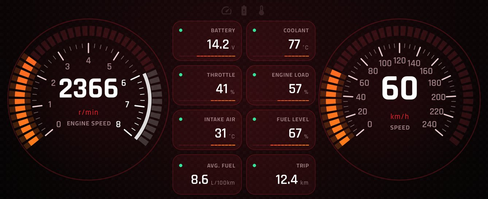
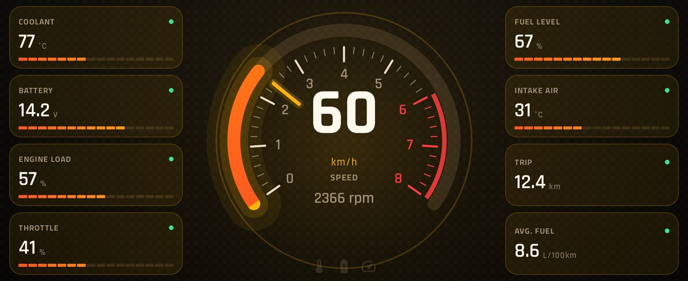

# JAC DRIVE – Ultimate Smart Cockpit

A native Android companion app for the **JAC J7 2026 Ultimate**: a customizable digital cockpit,
OBD-II live data and diagnostics through a Bluetooth ELM327 adapter, vehicle health, performance
timing, trip analytics and maintenance tracking. Arabic and English with full RTL.

Target device: Xiaomi Redmi Note 15 (any Android 8.0+ phone works; `minSdk 26`, `targetSdk 35`).

> **Status: Phase 1 of 5 complete.** Architecture, design system, navigation, the full cockpit with
> five themes and demo mode are working. Bluetooth/OBD communication is Phase 2. Screens whose
> engine arrives in a later phase are visibly marked **"In development"** in the app, and
> nothing in them pretends to work.


| Racing Red (Arabic RTL) | Cyber Blue · Digital | Sport GT · Sport center |
|---|---|---|
|  |  |  |

*Rendered from the real Compose code by the screenshot tests, using demo-mode (simulated) values.*

---

## Architecture

Kotlin · Jetpack Compose · Material 3 · MVVM + clean layering · Coroutines/Flow · Hilt · Room ·
DataStore · Navigation Compose · Gradle Kotlin DSL with a version catalog.

```
app ──► dashboard ──► vehicle ──┐
   ├──► diagnostics ─┐          │
   ├──► analytics ───┼──► obd ──┼──► core-ui ──► core
   ├──► maintenance ─┘          │
   └──► settings ───────────────┘
```

| Module | Responsibility |
|---|---|
| `core` | Domain models (`VehicleMetric`, `LiveValue`, `DataSource`, `VehicleSnapshot`, units), settings repository (DataStore), Room database, DI (dispatchers, app scope). No UI. |
| `core-ui` | Design system: typography (Cairo + Rajdhani), app theme, the five cockpit styles, Canvas gauge renderer (`CircularGauge`, `BarGauge`), cockpit backgrounds, shared components, immersive-mode helper. |
| `obd` | Live-data pipeline. `VehicleDataRepository` is the single source of truth for every screen. Phase 1: demo simulator + trip integrator. Phase 2 adds the ELM327 transport, PID discovery and SAE J1979 decoding behind the same interface. |
| `vehicle` | Vehicle profile (Room) with VIN validation. |
| `dashboard` | Home hub and the full-screen cockpit (3 layouts, warning lamps, freshness). |
| `diagnostics` | DTC scanner UI and vehicle-health screen (live checks are functional). |
| `analytics` | Trips and performance screens. |
| `maintenance` | Service items and intervals. |
| `settings` | Settings and Theme Studio. |

### Data honesty rules (enforced in code)

* Every value carries a `DataSource`: `ECU`, `ADAPTER`, `CALCULATED`, `PHONE_SENSOR` or `SIMULATED`.
* Every value carries a timestamp; each metric has a staleness threshold. Stale values are dimmed
  and marked; warning lamps only react to **fresh** values.
* `VehicleSnapshot.supportedMetrics == null` means "PID discovery hasn't run" — which is different
  from "unsupported". Unsupported metrics show **N/A**, never a guessed value.
* With no adapter and demo off, the app shows an explicit **NO ADAPTER** state with empty gauges.
* Demo mode shows a persistent **DEMO · SIMULATED** badge, a watermark and a banner. Demo values
  are never written to trips, diagnostics or history.
* Fault codes are never generated from demo data, and clearing codes will always require explicit
  confirmation (Phase 3).

## Build

Requirements: JDK 17+ (21 tested), Android SDK platform 35 + build-tools 35. Android Studio
Ladybug (2024.2) or newer opens the project directly.

```bash
# from the project root
./gradlew assembleDebug          # app/build/outputs/apk/debug/app-debug.apk   (~19 MB)
./gradlew assembleRelease        # app/build/outputs/apk/release/app-release.apk (~2.3 MB, R8-minified)
```

If you build outside Android Studio, create `local.properties` with `sdk.dir=/path/to/Android/sdk`.

**Release signing.** Create a git-ignored `keystore.properties` in the root:

```
storeFile=/absolute/path/jacdrive.jks
storePassword=…
keyAlias=jacdrive
keyPassword=…
```

Without it, the release APK is signed with the debug key (fine for installing on your own phone,
not for Play Store distribution).

## Install on the Redmi Note 15

1. Settings → About phone → tap **OS version** 7 times to enable Developer options.
2. Settings → Additional settings → Developer options → enable **USB debugging** (on HyperOS also
   enable **Install via USB**).
3. Connect USB and run `adb install -r app/build/outputs/apk/release/app-release.apk`,
   or copy the APK to the phone and open it (allow "Install unknown apps" for your file manager).

The debug build installs side-by-side as `com.jacdrive.app.debug`.

## Testing

```bash
./gradlew testDebugUnitTest            # JVM unit tests (all modules)
./gradlew lintDebug                    # Android lint
./gradlew :dashboard:recordRoborazziDebug   # render cockpit screenshots on the JVM
```

Screenshots are written to `dashboard/build/outputs/roborazzi/` (every theme, every layout,
Arabic RTL and the offline state).

| Tested in Phase 1 | How |
|---|---|
| Unit conversion, value freshness | `core` unit tests |
| Trip distance / fuel integration, gap handling | `obd` unit tests |
| Demo model stays physically plausible | `obd` unit test (20 000 steps) |
| Warning-lamp logic (incl. stale values ignored) | `dashboard` unit tests |
| Health classification | `diagnostics` unit tests |
| VIN format validation | `vehicle` unit tests |
| Cockpit rendering: 5 themes × layouts, RTL, offline | Roborazzi screenshot tests |
| Debug + minified release builds, lint (0 errors) | Gradle |

**Not yet tested on a physical phone or vehicle.** Manual check on the phone: launch → startup
animation → Home; Settings → enable Demo mode → open Cockpit (rotates to landscape, hides system
bars); switch theme/layout from the palette button; switch language to العربية (layout mirrors).

## Development phases

| Phase | Scope | Status |
|---|---|---|
| 1 | Architecture, UI/UX, navigation, cockpit, 5 themes, Theme Studio, demo mode, vehicle profile, settings | ✅ Done |
| 2 | Bluetooth Classic scanning/pairing, ELM327 init (ATZ/ATE0/ATL0/ATS0/ATH0/ATSP0), PID discovery (0100/0120/0140), live PIDs 010C 010D 0105 0104 0111 010F 010B 012F 010E, foreground service, reconnect, timeouts, BLE-ready transport interface | Next |
| 3 | Mode 03/07/0A DTC reading, MIL & readiness (0101), bilingual DTC database, severity/causes/steps, guarded Mode 04 clear, session history & comparison, health score | Planned |
| 4 | Performance timers + phone G-force, trip recording, charts, CSV export, maintenance intervals/reminders/costs | Planned |
| 5 | Alert engine with Arabic/English TTS, Android Auto feasibility + compliant implementation if eligible, backup/restore, full test pass, release APK | Planned |

## Android Auto – current position (to be finalised in Phase 5)

An ordinary phone app does **not** appear on the car screen. Android Auto only shows apps built
with the Car App Library (or media/messaging APIs) that fit one of Google's supported categories
(e.g. media, messaging, navigation, points of interest, IoT, weather — the list changes, so it will
be re-verified against Google's current documentation in Phase 5) and that render only through
Google's driver-safety templates. A custom instrument cluster with free-form gauges cannot be drawn
on the Android Auto screen, and JAC DRIVE will not use mirroring or other workarounds. The full
cockpit stays on the phone; if a category genuinely fits, a limited template-based companion will
be added. The `core`/`obd` modules have no phone-UI dependencies so they can also be reused for a
future Android Automotive OS build.

## Safety

Monitoring and diagnostics only. The app never controls steering or braking, never modifies ECU
settings, never disables safety systems, never sends arbitrary CAN frames and never clears fault
codes automatically. Acceleration tests are for closed, legal venues only.

## Licences

Fonts: Cairo and Rajdhani, SIL Open Font License 1.1 (see `LICENSES/`). Libraries: Apache 2.0.
